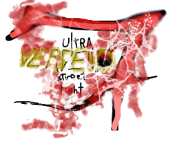
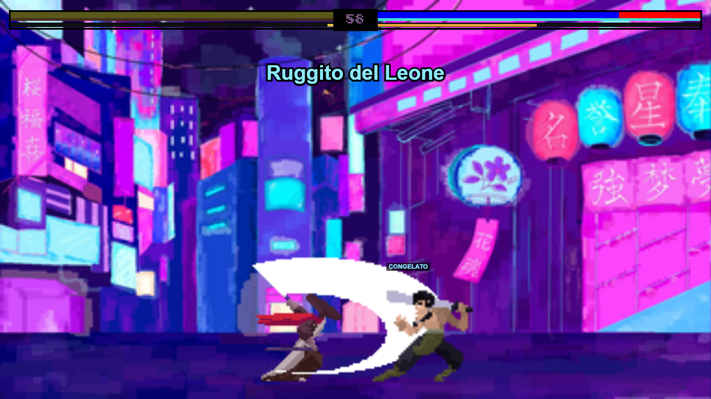
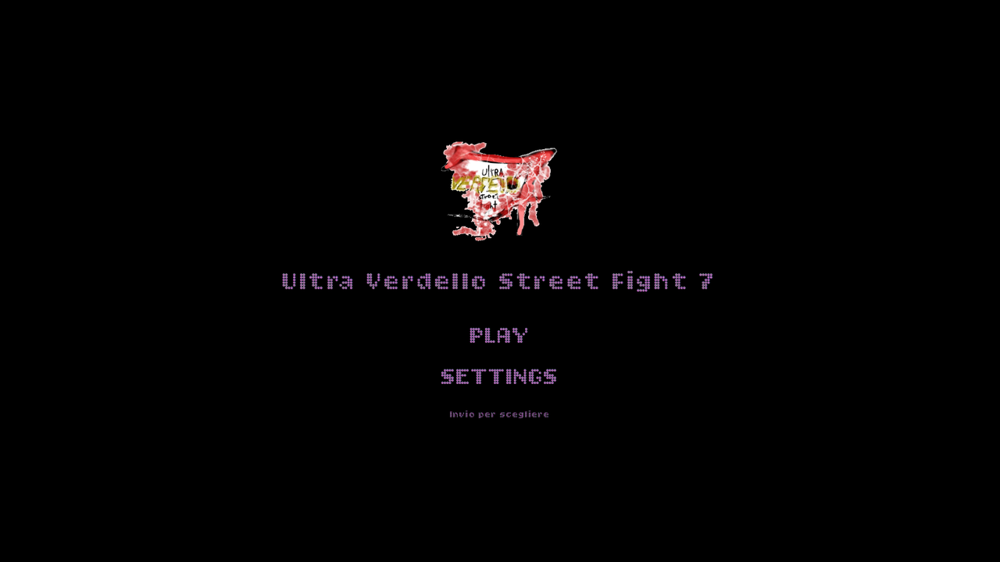
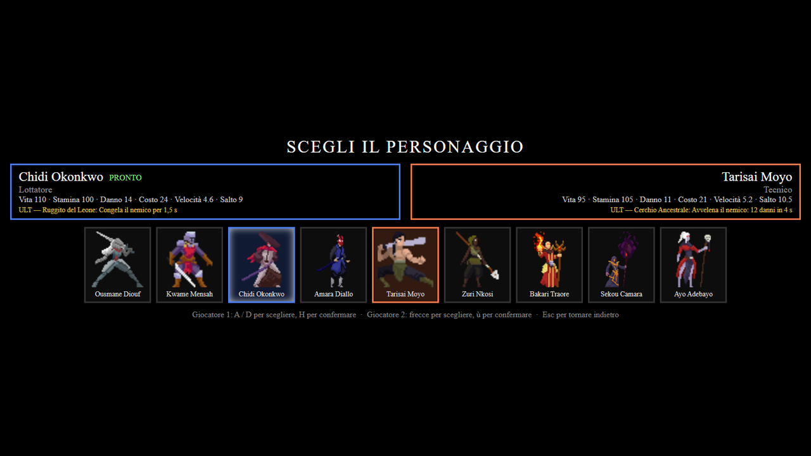
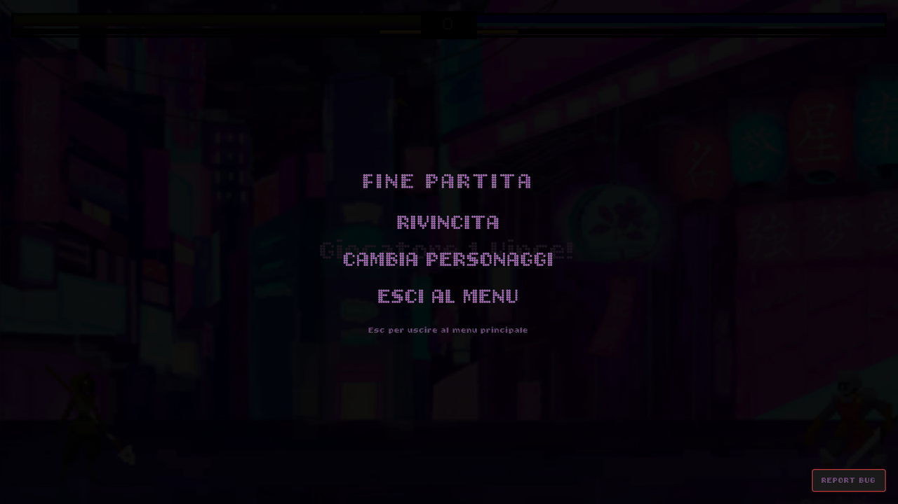
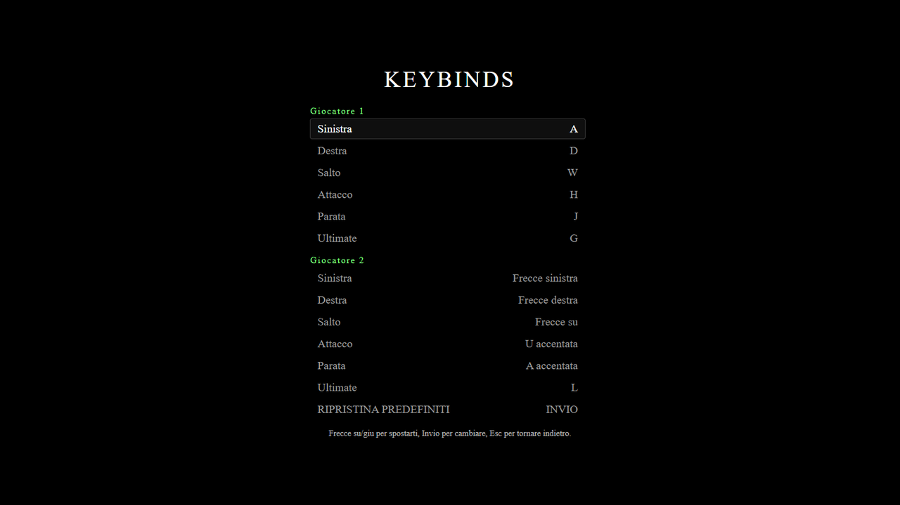
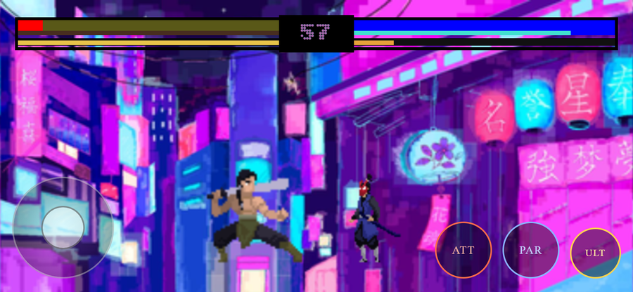
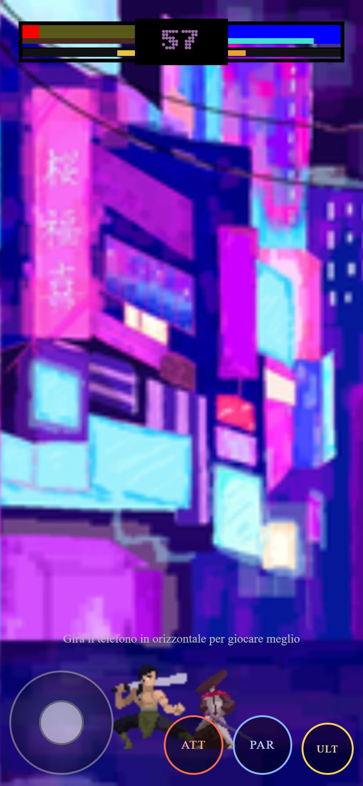

<p align="center">
  
</p>

<h1 align="center">Ultra Verdello Street Fight 7</h1>

<p align="center">
  Picchiaduro 2D in <strong>JavaScript vanilla</strong> su <strong>Canvas</strong>: due giocatori sulla stessa tastiera,
  contro una CPU con tre difficoltà, oppure online con stanze e codice.
</p>

<p align="center">
  
  
  
  
  
</p>

<p align="center">
  <strong>Server di gioco</strong> — l'indirizzo pubblico non è nel repository: si configura sul VPS
  (vedi <a href="#server-e-messa-online">Server e messa online</a>)
</p>



<p align="center">
  <em>Partita VS LOCALE: ultimate di Chidi Okonkwo, stato <code>CONGELATO</code> sull'avversario, HUD completo.</em>
</p>

---

## Indice

- [Galleria](#galleria)
- [Il gioco](#il-gioco)
- [Avvio rapido](#avvio-rapido)
- [Comandi](#comandi)
- [Meccaniche di combattimento](#meccaniche-di-combattimento)
- [I nove lottatori](#i-nove-lottatori)
- [VS ONLINE](#vs-online)
- [Report bug](#report-bug)
- [Server e messa online](#server-e-messa-online)
- [Struttura del progetto](#struttura-del-progetto)
- [Scelte tecniche](#scelte-tecniche)
- [Stato di sviluppo](#stato-di-sviluppo)
- [Qualità e verifiche](#qualità-e-verifiche)
- [Requisiti](#requisiti)
- [Crediti e licenze](#crediti-e-licenze)

---

## Galleria

Tutte le immagini sono prese dalla versione attuale del gioco.

| Menu principale | Selezione del personaggio |
|---|---|
|  |  |

| Fine partita con rivincita | Keybinds |
|---|---|
|  |  |

| Telefono in orizzontale | Telefono in verticale |
|---|---|
|  |  |

---

## Il gioco

Ultra Verdello Street Fight 7 (UVSF7) è un picchiaduro bidimensionale completo, scritto senza framework, senza bundler e senza una sola dipendenza npm: HTML, CSS e JavaScript più un piccolo server Node per la parte in rete.

**Cosa c'è dentro**

- **Tre modalità**: VS LOCALE (due giocatori, una tastiera), VS CPU (facile, difficile, guissè), VS ONLINE (stanze con codice su server).
- **Nove lottatori**, ognuno con statistiche, hitbox misurate sui pixel e ultimate propria.
- **Combattimento tecnico**: parata con *perfect block*, attacco caricato che rompe la parata, stun, stati alterati.
- **HUD completo**: vita, stamina e barra ultimate per entrambi, timer da 60 secondi.
- **Flusso di gioco completo**: menu principale, sottomenu, pausa, fine partita con rivincita.
- **Report bug integrato**: il giocatore scrive e invia, il report arriva al server senza scaricare file.
- **Mobile**: comandi touch (leva e tasti), selezione a tocchi, layout responsive.
- **Keybinds**: tasti rimappabili per entrambi i giocatori, salvati nel browser.
- **Strumenti di debug**: tasto `U` per le hitbox e pannello con frame e stati dei lottatori.

Il progetto è accompagnato da due documenti di lavoro tenuti aggiornati: [`sviluppo.md`](sviluppo.md) (piano a fasi, decisioni, bilanciamento) e [`bugs.md`](bugs.md) (32 bug con causa, fix e verifiche).

---

## Avvio rapido

### Solo gioco locale (VS LOCALE e VS CPU)

Apri `index.html` nel browser. Funziona anche da `file://`: nessun server richiesto.

Se preferisci servirlo da HTTP:

```bash
python3 -m http.server 8000
# poi apri http://localhost:8000
```

### Con il server (VS ONLINE e report bug)

```bash
node server/server.js                 # porta 80
PORTA=8080 node server/server.js      # porta diversa
```

Apri `http://localhost:8080`. Controllo immediato: `http://localhost:8080/stato` restituisce JSON con stanze aperte, connessioni e uptime.

### Indirizzo pubblico

**L'indirizzo del server non è versionato in questo repository**: né l'IP della VPS né il dominio
compaiono qui, quindi clonare il repo non espone l'infrastruttura. L'indirizzo vive solo sul server,
in due punti:

| Dove | Cosa contiene |
|---|---|
| `/etc/caddy/Caddyfile` | il nome pubblico e il reverse proxy verso Node |
| unità `systemd` del servizio | `PORTA=8090` e `HOST=127.0.0.1` |

Il nome pubblico può essere un dominio tuo, un sottodominio DuckDNS, oppure un nome `nip.io`
(`<nome>.<ip-del-server>.nip.io`) che risolve da solo senza registrare nulla. In tutti i casi il
gioco non cambia: il client parla con lo **stesso host da cui ha caricato la pagina**
(`location.host` in `js/Rete.js`), quindi nessun indirizzo è cablato nel codice.

Dietro c'è **Caddy** come reverse proxy: gestisce il certificato TLS e inoltra al server Node, che
ascolta solo su `127.0.0.1:8090`.

> Con `file://` funzionano solo VS LOCALE e VS CPU: senza server non esiste l'indirizzo WebSocket delle stanze né l'invio dei report.

---

## Comandi

### Tastiera (valori predefiniti)

| Azione | Giocatore 1 | Giocatore 2 |
|---|---|---|
| Sinistra / Destra | `A` / `D` | `←` / `→` |
| Salto | `W` | `↑` |
| Attacco (tieni premuto per caricare) | `H` | `Ù` |
| Parata (tieni premuto) | `J` | `À` |
| Ultimate (a barra piena) | `G` | `L` |

| Altro | Tasto |
|---|---|
| Pausa | `Esc` |
| Hitbox e pannello di debug | `U` |
| Report bug | `Esc` → `REPORT BUG` |

### Keybinds

`SETTINGS → KEYBINDS` (anche in partita: `Esc → IMPOSTAZIONI → KEYBINDS`). Si scorre con le frecce o `W`/`S`, si preme `Invio` e poi il tasto da assegnare. La configurazione è salvata nel browser (`localStorage`, chiave `uvsf7-keybinds`) e vale anche per i comandi touch. `RIPRISTINA PREDEFINITI` rimette tutto a posto. `Esc`, `Invio`, `Tab` e `U` sono riservati a menu, pausa e debug.

### Touch (telefono e tablet)

In partita compaiono da soli e solo su dispositivi touch:

- **leva virtuale** a sinistra: trascina a sinistra o destra per muoverti, verso l'alto per saltare;
- **ATT**: tienilo premuto per l'attacco caricato, rilascia per colpire;
- **PAR**: parata finché il dito resta sul tasto;
- **ULT**: ultimate.

In VS LOCALE ci sono due gruppi con sigla `P1` / `P2`, uno per lato. In VS ONLINE il telefono comanda il giocatore che lo sta usando. Nella schermata di selezione i pulsanti `<` `>` `CONFERMA` e le celle toccabili permettono di giocare senza tastiera.

### Menu

| Schermata | Voci |
|---|---|
| Principale | `PLAY`, `SETTINGS` |
| Play | `VS LOCALE`, `VS CPU`, `VS ONLINE`, `INDIETRO` |
| VS CPU | `FACILE`, `DIFFICILE`, `GUISSÈ`, `INDIETRO` |
| VS ONLINE | `CREA STANZA`, `ENTRA CON CODICE`, `INDIETRO` |
| Impostazioni | `FULLSCREEN`, `KEYBINDS`, `INDIETRO` |
| Pausa (`Esc`) | `RIPRENDI`, `IMPOSTAZIONI`, `ESCI AL MENU` |
| Fine partita | `RIVINCITA`, `CAMBIA PERSONAGGI`, `ESCI AL MENU` |

`Esc` fa sempre da tasto indietro: in ogni menu c'è anche la voce esplicita e una riga di aiuto che ricorda cosa fa.

---

## Meccaniche di combattimento

- **Vita e stamina**: attaccare e parare consumano stamina; la stamina si rigenera ogni due secondi (la bruciatura la blocca).
- **Parata**: blocca i danni finché hai stamina. Si può avviare solo da terra; saltare annulla la parata.
- **Perfect block**: parando entro **3 frame** dall'inizio dell'attacco avversario non subisci danno, guadagni **+15** di carica ultimate e l'attaccante resta **stunnato 1 secondo** mostrando l'animazione di danno.
- **Attacco caricato**: tieni premuto l'attacco per **1 secondo** (barra sopra il lottatore e scritta `CARICATO`). Al rilascio il colpo **rompe la parata**, infligge danno e stunna per 1 secondo. Costo: **1,5x** stamina. Durante la carica non puoi muoverti, saltare, parare o usare l'ultimate.
- **Ultimate**: barra dedicata sotto la stamina, piena in circa **20 secondi**, più veloce con le parate perfette, che si perde quando vieni stunnato (−25). Ogni ultimate ha tipo (mischia, proiettile, buff) ed effetto proprio.
- **Stun**: blocca movimento, salto, attacco, parata e ultimate; gli input premuti durante lo stun vengono ignorati.
- **Timer**: 60 secondi. Vince chi azzera la vita dell'avversario; allo scadere vince chi ha più vita.

### Stati alterati

| Stato | Effetto |
|---|---|
| `RALLENTATO` | velocità −50%, animazioni +80% |
| `INVERSO` | comandi invertiti |
| `ECLISSI` | inversione + rallentamento |
| `CONGELATO` | nessuna azione possibile |
| `VELENO` | 12 danni nel tempo |
| `BRUCIATO` | 14 danni nel tempo e stamina che non rigenera |
| `MARCHIATO` | +30% danni subiti |
| `SILENZIO` | niente ultimate, stamina in calo |
| `VELOCE` | buff: velocità +50%, animazioni −40% |

---

## I nove lottatori

Valori come mostrati nella schermata di selezione: `Danno` e `Costo` sono quelli dell'attacco base, il salto è il valore assoluto della spinta.

| Personaggio | Archetipo | Vita | Stamina | Danno | Costo | Velocità | Salto |
|---|---|---:|---:|---:|---:|---:|---:|
| Ousmane Diouf | Cavaliere | 100 | 100 | 8 | 14 | 5 | 10 |
| Kwame Mensah | Cavaliere agile | 95 | 100 | 11 | 19 | 5,5 | 11 |
| Chidi Okonkwo | Lottatore | 110 | 100 | 14 | 24 | 4,6 | 9 |
| Amara Diallo | Lottatore veloce | 90 | 100 | 9 | 17 | 6 | 11,5 |
| Tarisai Moyo | Tecnico | 95 | 105 | 11 | 21 | 5,2 | 10,5 |
| Zuri Nkosi | Cacciatrice | 88 | 100 | 10 | 18 | 5,8 | 11,5 |
| Bakari Traore | Mago | 85 | 110 | 13 | 20 | 4,4 | 9 |
| Sekou Camara | Mago anziano | 95 | 105 | 12 | 19 | 4,6 | 9,5 |
| Ayo Adebayo | Arcimago | 88 | 100 | 14 | 22 | 5 | 10 |

Regola di bilanciamento: attacco veloce e corto = meno danno e meno stamina; attacco lento e con hitbox grande = più danno e più costo. I maghi compensano il danno alto con meno vita. Le tabelle complete (avvio, durata, hitbox misurate in pixel) sono in [`sviluppo.md`](sviluppo.md).

### Ultimate

| Personaggio | Ultimate | Tipo | Danno | Effetto |
|---|---|---|---:|---|
| Ousmane Diouf | Radici del Baobab | Mischia | 20 | Rallentamento per 4 s |
| Kwame Mensah | Vortice di Vento | Mischia | 18 | Inversione comandi per 3 s |
| Chidi Okonkwo | Ruggito del Leone | Mischia | 24 | Congelamento per 1,5 s |
| Amara Diallo | Danza Fulminea | Buff | 0 | Velocità +50% per 5 s |
| Tarisai Moyo | Cerchio Ancestrale | Mischia | 20 | Veleno: 12 danni in 4 s |
| Zuri Nkosi | Freccia della Savana | Mischia | 18 | Marchio +30% per 5 s |
| Bakari Traore | Pioggia di Stelle | Proiettile | 24 | Bruciatura: 14 danni in 4 s |
| Sekou Camara | Giudizio degli Antenati | Proiettile | 22 | Silenzio per 4 s |
| Ayo Adebayo | Eclissi Arcana | Proiettile | 26 | Eclissi per 3 s |

I proiettili sono sfere animate disegnate sul canvas: viaggiano in avanti, rompono la parata e applicano danno e stato. Le ultimate da mischia colpiscono una sola volta per attivazione.

---

## VS ONLINE

Due giocatori su macchine diverse, stanza con codice di 4 caratteri.

### Flusso

1. `PLAY → VS ONLINE → CREA STANZA`: il server genera un codice, mostrato nel badge in alto.
2. L'altro apre lo stesso indirizzo, sceglie `ENTRA CON CODICE` e digita il codice.
3. Ognuno sceglie il proprio personaggio (la schermata mostra la propria scheda `TU` e l'altra come `AVVERSARIO`).
4. Quando entrambi confermano parte la partita.

### Come funziona la rete

| Ruolo | Chi | Cosa fa |
|---|---|---|
| **host** | chi crea la stanza | simula la partita nel proprio browser e manda **30 fotogrammi al secondo** all'ospite |
| **ospite** | chi entra col codice | non simula nulla: disegna lo stato ricevuto e manda le proprie **azioni** |
| **server** | `server/server.js` | serve i file e inoltra i messaggi dentro la stanza: non calcola il combattimento |

- Viaggia l'**azione** (sinistra, salto, attacco, parata, ultimate), non il tasto: ogni giocatore tiene i propri keybinds.
- Il campo di gioco è fissato all'inizio della partita (stesse misure del canvas dell'host) e il browser dell'ospite lo scala via CSS: le posizioni cadono negli stessi pixel.
- La CPU non ha una seconda logica di combattimento: scrive sugli stessi input del giocatore.

### Dopo la partita

- `RIVINCITA`: stessa coppia di personaggi, timer azzerato. In rete riparte per entrambi.
- `CAMBIA PERSONAGGI`: torna alla selezione; in rete la schermata si apre su tutti e due.

### Limiti noti

- La pausa (`Esc`) in VS ONLINE ferma solo il browser in cui viene premuta.
- Se chiude l'host, la partita finisce per entrambi; se chiude l'ospite, l'host torna al menu.
- Non c'è riconnessione automatica: si ricrea la stanza.

---

## Report bug

`Esc` in partita → `REPORT BUG`. Si scrive il problema e si preme **INVIA**:

- il contesto viene allegato da solo (stato, modalità, difficoltà, timer, personaggi, posizioni, vita, stamina, ultimate, frame);
- il gioco fa `POST /report` e il server accoda il report in `/var/lib/uvsf7/reports/report-AAAA-MM-GG.md`, con data, IP e user agent;
- **non serve scaricare nessun file**;
- se il server non risponde, il report resta in `localStorage` e viene reinviato alla riapertura del pannello. `ESPORTA MD` e `COPIA` restano come riserva.

Lettura dei report (serve la chiave impostata in `REPORT_CHIAVE`):

```bash
curl "http://<server>/reports?chiave=<CHIAVE>"
curl "http://<server>/reports/file?chiave=<CHIAVE>&nome=report-2026-10-17.md"
```

---

## Server e messa online

Il server è **un solo file Node, senza dipendenze**: HTTP statico più WebSocket e stanze, scritti a mano (handshake, frame di testo, ping/pong, close). Con 1 GB di RAM regge molte stanze, perché il combattimento non gira lì.

```bash
node server/server.js
```

| Variabile | Default | Significato |
|---|---|---|
| `PORTA` | `80` | porta HTTP/WebSocket (in produzione `8090`, dietro Caddy) |
| `REPORT_DIR` | `/var/lib/uvsf7/reports` | cartella dei report |
| `REPORT_CHIAVE` | *(vuota)* | chiave per leggere i report; se vuota la lettura risponde 403 |
| `HOST` | `0.0.0.0` | indirizzo di ascolto; con il proxy davanti si usa `127.0.0.1` |

| Endpoint | Descrizione |
|---|---|
| `GET /` | il gioco |
| `GET /stato` | JSON con stanze, connessioni e uptime |
| `POST /report` | invio di un report bug |
| `GET /reports?chiave=…` | elenco dei file di report |
| `GET /reports/file?chiave=…&nome=…` | contenuto di un file di report |
| `WS /ws` | canale delle stanze (funziona anche dietro proxy: Caddy inoltra l'upgrade) |

### Installazione su VPS (Ubuntu 24.04)

```ini
# /etc/systemd/system/uvsf7.service
[Unit]
Description=Ultra Verdello Street Fight 7
After=network.target

[Service]
Type=simple
WorkingDirectory=/opt/uvsf7
ExecStart=/usr/bin/node /opt/uvsf7/server/server.js
Restart=always
RestartSec=3
Environment=PORTA=80
Environment=REPORT_DIR=/var/lib/uvsf7/reports
Environment=REPORT_CHIAVE=cambia-questa-chiave

[Install]
WantedBy=multi-user.target
```

```bash
systemctl daemon-reload && systemctl enable --now uvsf7
ufw allow 80/tcp
curl http://<ip-pubblico>/stato
```

Sul server servono solo `index.html`, `index.js`, `css/`, `js/`, `server/` e gli asset davvero usati (`assets/Background.png`, `assets/UVSF7-logo.png`, `assets/Personaggi/`): circa 1,5 MB.

### HTTPS con un nome fisso (Caddy + dominio)

Installazione in [`server/LEGGIMI.md`](server/LEGGIMI.md). In breve: Caddy su 80/443 con certificato Let's Encrypt automatico, Node spostato su `127.0.0.1:8090` e reverse proxy verso di lui (WebSocket compreso).

```caddyfile
# <tuo-dominio>  =  il nome pubblico che scegli (dominio, DuckDNS o nip.io)
<tuo-dominio> {
    encode zstd gzip
    reverse_proxy 127.0.0.1:8090
}
```

Se un giorno compri un dominio (o usi DuckDNS), cambia solo la prima riga del `Caddyfile` e il link nel README: il certificato si rinnova da solo.

---

## Struttura del progetto

```
index.html            markup: canvas, HUD, menu, schermate, pannelli
index.js              game loop, fisica, collisioni, combattimento, avvio partita
css/style.css         tutti gli stili, responsive compreso
js/Utili.js           costanti condivise, caricamento asset, timer, vincitore
js/Stato.js           macchina a stati del gioco
js/Keybinds.js        tasti rimappabili: dati, salvataggio, schermata
js/Report.js          pannello report bug e invio al server
js/Menu.js            menu come dati, voci WIP, suggerimenti, fullscreen
js/Classi.js          classi Sprite e Lottatore: animazioni, hitbox, attacco
js/Personaggi.js      dati dei 9 lottatori, sprite, bilanciamento
js/Selezione.js       scelta del personaggio, diversa per modalità
js/CPU.js             avversario controllato dal computer, tre difficoltà
js/Rete.js            collegamento WebSocket con il server
js/Online.js          VS ONLINE: stanze, fotogrammi di stato, azioni
js/Touch.js           leva e tasti virtuali
server/server.js      HTTP + WebSocket + stanze + report
server/LEGGIMI.md     installazione e messa online
assets/Personaggi/    sprite per personaggio: idle, run, jump, fall, attack, takehit, death, parry
assets/               sfondo animato, logo, sprite storici Player/Enemy
sviluppo.md           piano a fasi, decisioni, tabelle di bilanciamento
bugs.md               32 bug con causa, fix e verifiche
```

| File | Righe |
|---|---:|
| `index.js` | 1331 |
| `js/` (12 file) | 3713 |
| `server/server.js` | 671 |
| `css/style.css` | 1126 |
| `index.html` | 142 |

Circa **5.000 righe di JavaScript** scritte a mano, senza generare nulla a partire da framework.

### Ordine di caricamento degli script

```
Utili → Stato → Keybinds → Report → Menu → Classi → Personaggi
      → Selezione → CPU → Rete → Online → Touch → index
```

L'ordine conta: gli script condividono lo scope globale e usano solo dichiarazioni di funzione, così nessuno dipende da un file caricato dopo (era il bug BUG-12, ora chiuso).

---

## Scelte tecniche

- **Niente framework, niente build step, niente npm.** Si apre il file e funziona; il server usa solo moduli standard di Node.
- **Logica per frame, non `deltaTime`.** Frame d'impatto, perfect block, stun e carica sono contati in frame: il combattimento è deterministico e leggibile.
- **Una sola fonte di verità per l'attacco**: la fine dell'animazione è decisa dal `Lottatore`, non da `setTimeout`.
- **Host autoritativo in rete**: un solo simulatore, niente rollback né predizione. L'ospite vede lo stato con la latenza della rete.
- **Input a strati**: tasto fisico → `azioneDaTasto()` → `premiAzione()`. Tastiera, keybinds, comandi touch e ospite online passano tutti da qui.
- **Misure dai pixel**: `scale`, `offset`, hitbox e frame d'impatto di ogni personaggio sono stati misurati sui fogli reali; su schermi stretti tutto viene riscalato con un unico fattore, così le collisioni restano coerenti.
- **Dati, non codice**: menu, personaggi e keybinds sono tabelle; aggiungere una voce o un lottatore non richiede toccare il game loop.

---

## Stato di sviluppo

| Fase | Contenuto | Stato |
|---|---|---|
| 1 | CSS esterno, stati di gioco, menu, fullscreen | completata |
| 2 | Selezione personaggio, 9 lottatori con sprite dedicati | completata |
| 3 | Perfect block, ultimate, attacco caricato, stun | completata |
| 4 | VS CPU con tre difficoltà | completata |
| 5 | VS ONLINE: server, stanze, fotogrammi di stato | completata |
| 6 | Keybinds, touch, rivincita, selezione per modalità, report sul server | completata |

**Ancora aperto (marcato WIP nel progetto)**

- animazioni di parata: `parry.png` di alcuni personaggi è ancora un segnaposto;
- salto e caduta di Bakari Traore sono provvisori (assenti nel pacchetto originale);
- effetti sonori e musica: non ancora iniziati.

---

## Qualità e verifiche

Il progetto tiene un registro dei bug reale, non decorativo:

- **32 bug** documentati in [`bugs.md`](bugs.md) con causa, impatto, fix e verifica: tutti chiusi. Dove la correzione è parziale il motivo è dichiarato (per esempio la dipendenza dal frame rate è una scelta di progetto: logica per frame, senza `deltaTime`).
- **12 giri di fix** con data, elenco delle modifiche e tabella delle verifiche eseguite.
- Verifiche fatte nel browser reale, non solo a occhio: frame fatti avanzare a mano per controllare stun, carica, perfect block e fine partita; due schede collegate al server per la rete; viewport telefono per il layout mobile.

Controlli tipici dopo una modifica:

1. `node --check` su tutti i file JS toccati.
2. Partita VS LOCALE: attacco normale, attacco caricato, parata, perfect block, ultimate.
3. VS CPU su tutte e tre le difficoltà.
4. VS ONLINE: creazione stanza, ingresso col codice, rivincita, uscita dell'avversario.
5. Mobile: menu, selezione a tocchi, comandi touch.
6. Report bug: invio e presenza del file sul server.

---

## Requisiti

- Browser moderno con Canvas 2D (Chrome, Edge, Firefox, Safari); nessun plugin.
- Per VS ONLINE e report: Node 18 o superiore per il server.
- Telefono o tablet: funziona con i comandi touch; in VS LOCALE lo schermo stretto rende meglio su tablet, mentre il telefono è ideale come secondo giocatore in VS ONLINE.
- Il canvas si adatta alla finestra; durante una partita online il campo resta fisso per non far divergere le posizioni.

---

## Crediti e licenze

- **Sprite dei personaggi**: pacchetti [luizmelo](https://luizmelo.itch.io/) (Hero Knight, Huntress, Martial Hero, Evil Wizard e altri), **CC0** — uso libero, anche commerciale.
- **Sprite di riserva** in `assets/sprite-gratuiti/`: AutoSprite Free Asset Library, **CC0**.
- **Font**: Bitcount Prop Double Ink di Google Fonts.
- **Sfondo, logo e screenshot**: realizzati per il progetto.
- **Codice**: scritto dall'autore del repository; pubblicato per consultazione e uso didattico.

Progetto scolastico di TPS (Tecnologie e Progettazione di Sistemi) — JavaScript, Canvas e un server Node scritti da zero.
